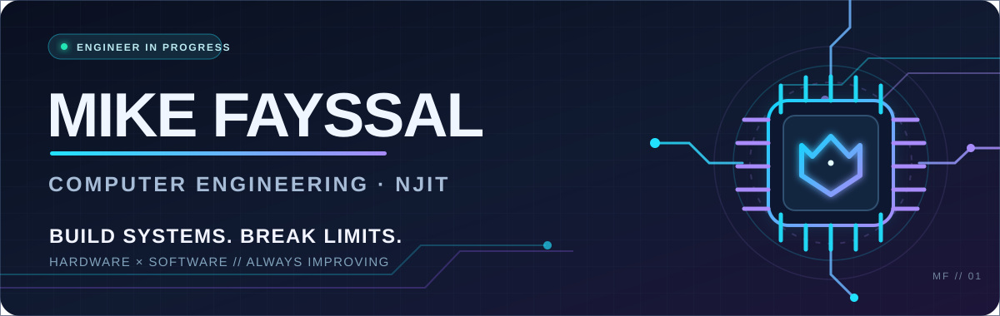

  

  
  
  

## Hey, I'm Mike 👋

I'm a **computer engineering student at NJIT** who enjoys the space where **hardware meets software**. I want to understand how systems work from the circuit level up—and turn that knowledge into things I can actually build, test, and improve.

I bring the same mindset to engineering that I bring to training and competition: **show up, stay disciplined, learn fast, and keep raising the standard.**

> **My approach:** Build it. Test it. Learn from it. Make it better.

### ⚡ What I'm focused on

- **Embedded systems:** connecting code, electronics, and real-world devices
- **Digital design:** logic, computer architecture, and hardware fundamentals
- **Circuits & simulation:** analyzing, designing, and validating electrical systems
- **Signals & software:** using programming to model, measure, and solve problems

### 🧰 Tools and topics on my radar

  
  
  
  
  
  
  

*These are areas I'm learning and working with—not a claim that I've mastered them all.*

### 🚀 What you'll find here

I'm building this GitHub into a record of **real engineering progress**. Areas I plan to document include:

| Area | What I want to build and share |
| :-- | :-- |
| 🔌 **Circuits & simulation** | LTspice experiments, design decisions, and test results |
| 🤖 **Embedded projects** | Sensor-based systems and microcontroller prototypes |
| 🧠 **Digital logic** | Logic design, timing, and hardware experiments |
| 📊 **Signals & computing** | MATLAB/Python models and engineering problem-solving |

*I'll replace these directions with links to completed projects as I publish them.*

### 🏈 Beyond the keyboard

You'll probably find me **at the gym, playing football, gaming, or watching anime**. I like a challenge, I care about my team, and I'm always trying to be better than I was yesterday.

---

  <strong>Curiosity → Discipline → Execution → Growth</strong> 
  Learning in public. Building with purpose. One project at a time.

